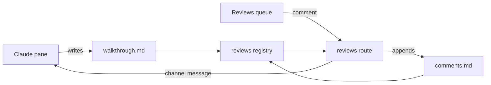

# Walkthrough

A walkthrough is a comprehension document. Tom reads three or four a day, at architecture altitude, having read almost none of the code. Each `##` stop is one **structural claim**: a subsystem added, an existing one extended, machinery reused, the rest of the system touched, or behavior changed. Its refs point at the diff hunks that prove the claim; periscope shows those hunks collapsed under the stop. Tom reads the claims and opens the evidence only to check one.

Write about structure: what owns what, what depends on what, which boundary moved, what was built new versus pulled in from elsewhere, what changed for the rest of the system and its infra. A stop is a claim about structure, and every ref sits under the claim it evidences. Line-level findings belong to `/code-review`, a separate artifact.

The diff and the live code are the source. The PR body is the author's claim; verify anything taken from it before it enters a stop.

## Steps

### 1. Locate the file

Run in the branch's worktree (`git worktree list` finds it when the branch is checked out elsewhere). Run each command below as its own Bash call: Claude Code's worktree guard refuses git inside `$(…)`, loops, heredocs or `&&` chains, and no shell variable survives between calls anyway. Read each printed value off and write it as a literal into later commands; `<repo>`, `<dir>`, `<head>`, `<base>` and `<pr>` below mean those values.

```sh
git rev-parse --path-format=absolute --git-common-dir  # prints a path; drop its last segment (/.git) to get <checkout>
realpath <checkout>                                    # the last segment of this is <repo>
git rev-parse --abbrev-ref HEAD                        # <branch>
git rev-parse --short HEAD                             # <head>
git symbolic-ref --short refs/remotes/origin/HEAD      # origin/<default>; on an error use main
git merge-base origin/<default> HEAD                   # <base>
gh pr view --json number -q .number                    # <pr>; "no pull requests found" means no PR
mkdir -p ~/.claude/reviews/<repo>/<slug>               # <dir>; <slug> is <branch> with every / turned into --
```

The first two commands are the split form of periscope's repo label, `basename "$(realpath "$(dirname "$(git rev-parse --path-format=absolute --git-common-dir)")")"`, which outside a worktree runs as-is. From a linked worktree it names the main checkout, not the worktree directory, and any other derivation writes a file periscope never finds. When periscope's prepare message names a path, it is this same path.

The base is the merge-base with the repo's default branch, the same base periscope's walkthrough view diffs against, so the diff you group is the one Tom sees. A stacked PR therefore shows the whole stack; say so in the problem paragraph.

### 2. Read comments.md first

If `<dir>/comments.md` exists, read it before the diff. Its unresolved entries are Tom's questions about specific stops, and this run has to answer them (step 6).

### 3. Read the diff

Write the diff once to a scratch file and read it from there. `<scratch>` is your scratchpad directory when your system prompt lists one, else `/tmp`.

```sh
git diff -M --stat <base>                              # the shape: what moved, how much
git diff -M <base> > <scratch>/diff.patch              # every hunk, for reading and for step 5
```

Diffing the worktree against `<base>` with no second ref is what periscope renders, uncommitted edits to tracked files included. Untracked files are invisible to both; if they matter, say so in the problem paragraph.

Start from the stat and group files into conceptual units: a new module, its route and its tests are one subsystem. For each unit, read the live code around it and `grep -rn` its new names across the repo to learn what it calls and what calls it. This step is done when every file in the stat belongs to a stop or is knowingly incidental (a stop's own tests, lockfiles, generated bundles).

### 4. Write walkthrough.md

Write `<dir>/walkthrough.md` in the format below, stops ordered as in "Ordering", with diagrams where "Diagrams" calls for them. A re-run rewrites the file wholesale with the new `head`, keeping the titles of stops that still hold so their comments stay attached. A re-run leaves `comments.md` alone apart from step 6, and never touches `reviewed.json` (periscope's reviewed marks).

### 5. Verify

Every ref must land on a hunk: its path appears in the diff, and its range overlaps a hunk's new side. A hunk header `@@ -a,b +c,d @@` covers new lines `c` to `c+d-1`. A ref that misses shows nothing under its stop.

```sh
grep -n '^diff --git\|^@@' <scratch>/diff.patch        # every file, each followed by its hunk headers
```

Then confirm periscope parses the header and counts the stops. `--no-sync` keeps uv from touching the prod checkout's environment. `--directory` runs only this command from that checkout, which is what makes `periscope` importable, and leaves your shell's working directory where it was.

```sh
uv run --no-sync --directory ~/dev/periscope python -c 'import sys,pathlib; from periscope import reviews as r; t=pathlib.Path(sys.argv[1]).read_text(); print(r.parse_header(t), r.count_stops(t))' <dir>/walkthrough.md
```

Expected: a dict carrying your `head`, and the number of stops you wrote. `None` means a header quote line is not `key: value` pairs. A `ModuleNotFoundError` means the reviews module is not on periscope's main yet; the check is unavailable, so rely on the format rules.

### 6. Address comments

Each entry in `comments.md` is a heading, the resolved line directly under it, then Tom's body:

```markdown
## 2026-10-26T09:14 · Adds a review registry over files outside the repo
> resolved: no

Why does this live outside the repo?
```

Periscope appends entries. Inside an entry you may do two things and nothing else. Append a reply paragraph to the end of its body, starting `Reply (<head>):`; periscope renders it under Tom's comment. Flip `> resolved: no` to `> resolved: yes` in place, and only when the question is actually addressed: answered in the reply, answered by a rewritten stop, or fixed in a commit. A comment that needs Tom's decision stays `no`, with a reply saying what the decision is. Every heading line stays byte-for-byte as periscope wrote it.

A comment can also arrive mid-session as a periscope channel message naming the stop; its entry is already in `comments.md`, so handle it the same way.

## Format

```text
# <what the branch does, in words>

> branch: <branch> · head: <short sha> · pr: <number>
> repo: <repo>

<one paragraph: the problem, no code vocabulary>

## <stop: a claim>
> kind: <kind> · refs: <ref>, <ref>

<prose>
```

- **The H1 is the file's first line.** Periscope's view reads the header only when the document opens with the H1.
- **Metadata quotes are raw `key: value` lines.** The header quote sits directly after the H1, the stop quote on the line directly under its `##`. Every line after its `>` is pairs with a lowercase key, separated by ` · `. A prose line, a blank `>` line or markup on a key turns the quote into an ordinary blockquote, and periscope loses the header or the stop's kind and hunks. Periscope reads the source characters as written, so header values go in plain: markup in a value becomes part of the value.
- **Header pairs.** `branch` and `head` (the step-1 value; periscope flags staleness against it) are required. `pr` is the bare number from step 1; with no PR, leave the `pr` pair out entirely, because an empty `pr: ` drops the whole header. `repo` is the step-1 value.
- **Problem paragraph.** One paragraph, readable by someone who has never seen the code: the need, not the modules. Periscope takes the first paragraph after the header as the problem.
- **Stops.** ATX `##` headings only; a `##` inside a code fence is not a stop. The title is the claim in plain text ("Adds…", "Reuses…", "Routes…"). Comments attach to the exact title, so keep titles stable across re-runs.
- **Refs.** Comma-separated, repo-relative, line numbers on the new side (the file as it stands now). Write them raw: `periscope/__init__.py:1-5` parses as-is, and a ref wrapped in backticks works too. A bare `path` shows every hunk of that file; `path:a-b` shows the hunks overlapping `a-b`, which narrows only inside an edited file. A new file is a single hunk, so any ref into it shows the whole file. A deleted file takes a bare path; a renamed one its new path.
- **Spellings that need a line suffix.** A file at the repo root needs one (`vite.config.js:1-40`). So does an extensionless file one directory deep (`bin/check:1-20`). In prose, a slashless name (`reviews.py`) chips only with a suffix (`reviews.py:12`).
- **Spellings that never parse.** An extensionless root file (`Makefile`), a root dotfile (`.gitignore:2`), a root file with a one-letter extension (`main.c:4`), any path containing `[`, `]`, `+` or `@` (`app/[id]/page.tsx`), and `~/` or absolute paths. Name these in prose.
- **Generated paths.** A path under `static/dist/` chips, but it points at the built bundle. Cite the source under `static/src/` instead.
- **Prose.** What the thing is, what it owns, what it depends on, and why it has this shape. A `path:line` token in prose becomes a chip that opens the file, so prose can cite code outside the diff, such as the existing function a reuse stop pulls in. A prose cite containing `__` goes in backticks (`periscope/__init__.py:1-5`); bare, markdown reads the underscores as emphasis and the chip breaks.

## The five kinds

- **new-subsystem**: a module or package with one responsibility that did not exist before. Name what it owns and what it depends on.
- **extension**: an existing subsystem grew. Name which one and what it now also does.
- **reuse**: existing machinery pulled into the feature. Name the existing thing, cite its definition in prose, and say why it is the right home. Also ask the converse: does an existing function already own this concept, so that new code duplicates it? Say so when it does.
- **system-touch**: a change outside the feature: a shared contract, schema, config, CI, infra, a dependency, a boundary crossed.
- **behavior**: something a user or another system observes differently. Every observable change gets its own behavior stop, however small.

Shared machinery refactored so the feature can reuse it, such as a helper extracted that every caller now goes through, is `system-touch`: it changes a path every existing caller takes.

## Ordering

Order stops by damage-if-wrong; the first stop is the one Tom must not skip. By default new-subsystem and system-touch stops come first, then behavior, then extension and reuse. Damage-if-wrong may move any stop ahead of that default, including a risky reuse stop ahead of the behavior stops. Three to ten stops fit most branches; a small branch can have one. Merge only like claims, and give each observable behavior change its own stop.

## Diagrams

Draw a mermaid `flowchart` on a stop that introduces a new boundary or changes a path every existing caller takes. Two or three per walkthrough is the usual count, well short of one per stop; a stop that only consumes an existing module gets none. Show the mechanism: who calls whom, what flows where, what crosses the boundary. Mermaid goes in a ```` ```mermaid ```` fence. The view draws a stop's diagrams in a full-width row above its text, so a diagram should make sense before the prose explains it.

## Example

````markdown
# Review walkthroughs native to periscope

> branch: feat/review-walkthrough · head: 562bc92 · pr: 412
> repo: periscope

Reviewing a branch today means reading a guide in one place, finding the changes it describes in another, and asking questions in a third. This branch puts the guide, its evidence and the conversation in one view, and adds a queue showing which reviews are waiting.

## Adds a review registry over files outside the repo
> kind: new-subsystem · refs: periscope/reviews.py:1-180, periscope/routes/reviews.py

A new module owns the convention for review files under ~/.claude/reviews: where a branch's walkthrough and comments live, how to read their headers, and which pane owns a branch. It depends on the published state snapshot for live panes and on gh for open PRs, and writes nothing to git.



## Splits the diagram renderer into its own bundle chunk
> kind: system-touch · refs: vite.config.js:1-40, package.json:12-30

Mermaid is a new dependency, loaded on the first diagram rather than at boot, so the dashboard's startup bundle stays the size it was.

## Removes the LGTM review tab
> kind: behavior · refs: periscope/lgtm.py, static/src/split/Detail.jsx:200-260

The Review tab on a pane card is gone; review now starts from the queue. A saved selection naming an LGTM session is dropped on restore, so the first reload after upgrading opens the default view.

## Reuses the channel push to deliver comments
> kind: reuse · refs: periscope/routes/reviews.py:300-345

Comments reach the owning pane through the same channel push that notify rides (periscope/channels.py:410). It already maps panes to sessions and fails loudly when the pane is gone, which the route reports as a 409.
````
